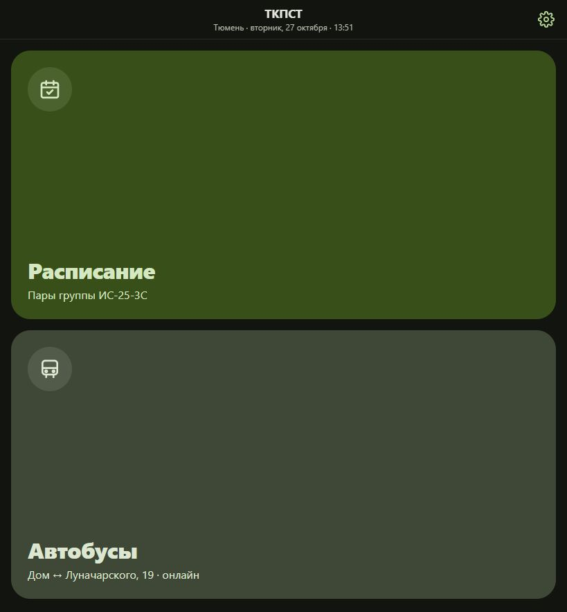
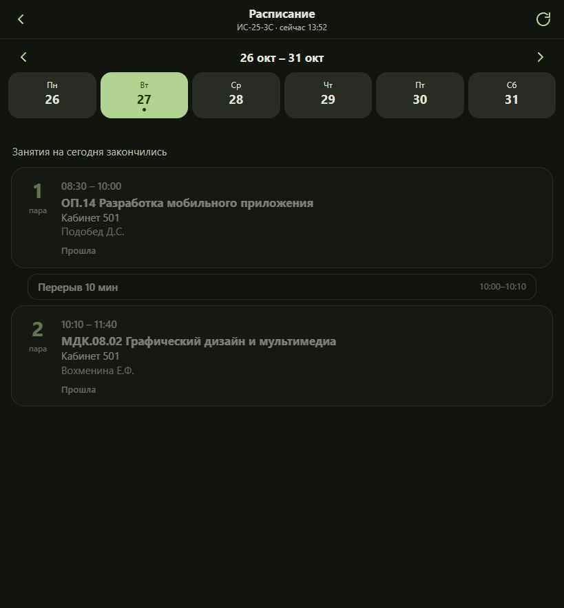

# ТКПСТ: оценка интерфейса и макеты успеваемости

Дата: 27 октября 2026. Пользователь подтвердил: вкладка показывает личные оценки студента.

## Что просмотрено

Изучены README, веб-маршруты и слой данных, цветовые токены веб- и Android-версий. В браузере открыта опубликованная веб-версия. Нативные приложения не запускались.

1. **Главная — понятная, но малоинформативная.** Две крупные кнопки хорошо видны, но занимают почти весь экран. Нет краткой информации об учебном дне и постоянного переключения разделов.

2. **Расписание — полезное, но завершённые занятия плохо читаются.** Есть выбор дня и недели, время, предмет, кабинет и преподаватель. В тёмной теме вся прошедшая пара сильно приглушается. Между расписанием и автобусами нужно возвращаться через главную.

Ограничения: просмотрена веб-версия при размере области 819 × 884. Это не проверка интерфейса на физическом телефоне. Контраст и масштабирование шрифтов инструментально не измерялись. Автобусы, геолокация, уведомления и админ-панель в этот визуальный обзор не входят.

## Предлагаемая структура

- Постоянные нижние вкладки: «Расписание», «Успеваемость», «Автобусы». Настройки доступны через кнопку в заголовке.
- «Успеваемость»: личный журнал с выбором семестра, средним баллом и списком предметов.
- По предмету: понятное название, последние оценки, средний балл; переход к истории с датой и видом работы.
- Оценки обозначаются цифрами и подписями; цвет дополняет смысл.
- Длинные названия предметов переносятся. Основной текст от 14–16 px, зоны нажатия не меньше 44 px.
- При отсутствии оценок — «Оценок пока нет»; при отсутствии данных — «Нет данных», без подстановки нулевого балла.
- При ошибке загрузки сохраняются последние доступные оценки с датой обновления и действием «Повторить».

## Визуальные направления

Три независимых макета одного экрана, логический размер 390 × 844. Сохраняются русские подписи, название ТКПСТ и группа ИС-25-3С. Различаются иерархия и организация журнала: спокойный светлый список, тёмный обзор с акцентом на результат, компактный журнал оценок. Это изображения для выбора направления, без реализации интерфейса.

В порядке показа в чате:

1. [Макет 1](mockups/01-personal-grades-light.png)
2. [Макет 2](mockups/02-personal-grades-dark.png)
3. [Макет 3](mockups/03-personal-grades-journal.png)

Все три результата визуально просмотрены: заголовки, предметы и нижняя навигация видны; основной контент не перекрыт. Изображения не проверяют реальную интерактивность, точные размеры зон нажатия и поддержку системного увеличения текста. Средние значения и коды предметов в изображениях иллюстративны и требуют сверки при реализации.

## Данные и дальнейшая разработка

В текущем клиентском коде не найдено модели оценок, API личной успеваемости и входа студента. В README описана отдельная закрытая админ-панель, но её код отсутствует в этом проекте. Её возможности по оценкам не проверены.

Все оценки в макетах — демонстрационные. Перед подключением реальных данных нужно определить их источник и способ идентификации студента. Личные оценки нельзя добавлять в публичный overrides.json или хранить в открытом репозитории.

Средний балл в будущем должен рассчитываться по согласованному правилу: если работы имеют веса или разную шкалу, нельзя автоматически считать все оценки равнозначными. До определения правила показатель в макете считается примером, а не официальным результатом.

Пользователь выбрал вариант 1. Он является визуальной основой дальнейшей работы. В следующем сообщении пользователь уточнил необходимость личного кабинета и затем подтвердил: сейчас проектируем ЛК, источник данных определим позже.

## Личный кабинет — дополнение к выбранному варианту

Сохраняем светлый дизайн первого варианта. Добавлены два экрана:

- [Вход в личный кабинет](mockups/04-account-login.png): логин, пароль с переключением видимости, кнопка «Войти», помощь со входом, возврат к расписанию.
- [Профиль студента](mockups/05-account-profile.png): пример имени и группы, роль «Студент», переход к личным оценкам, настройки, выход.

Это визуальные макеты, не работающая авторизация. Оба изображения просмотрены: текст и формы читаются, элементы не перекрываются, визуальная система соответствует выбранному варианту. Имя в профиле вымышленное.

### Сценарии переходов

1. Предлагаем оставить расписание и автобусы доступными без входа.
2. При открытии «Успеваемости» без активного входа показываем форму ЛК. Оценки до входа не отображаются.
3. После успешного входа открываем личную успеваемость по выбранному варианту 1.
4. Для перехода в профиль предусматриваем кнопку с иконкой пользователя в верхней панели. Настройки остаются доступны из профиля. Четвёртую нижнюю вкладку не добавляем.
5. «Мои оценки» в профиле возвращает к вкладке успеваемости.
6. Выход завершает сеанс и убирает личные оценки с экрана; расписание и автобусы продолжают работать.

### Состояния для будущей реализации

- Пустые поля: подсказка под соответствующим полем.
- Отправка формы: «Входим…», повторная отправка заблокирована.
- Неуспешный вход: общее сообщение «Не удалось войти. Проверьте логин и пароль», без раскрытия наличия учётной записи.
- Нет сети: сообщение и возможность повторить.
- Сеанс истёк: предложение войти снова; личные данные не показываются.
- Успешный вход, но оценок пока нет: понятное пустое состояние без нулевого среднего балла.
- Способ восстановления доступа и выдачи учётной записи определим после выбора источника данных. Регистрацию, отправку писем и смену пароля пока не проектируем как подтверждённые функции.

### Граница текущего этапа

На этапе создания макетов рабочий код приложения не менялся. API, способ входа, хранение сеанса и правила выдачи учётных записей пока не выбраны. Поля «Логин / Пароль» — предложение интерфейса, которое можно адаптировать под будущий источник данных.

При реализации сервер должен сам определять студента по сеансу и проверять доступ к его оценкам. Выбор группы или скрытие чужих оценок только в интерфейсе не заменяет проверку доступа. Изменения для Android, iOS и веба ещё не выполнялись.

## Реализация веб-дизайна

По следующему запросу пользователя первый макет перенесён в `web/`: общее оформление, нижние вкладки, журнал, раскрытие предмета, выбор семестра и демонстрационный кабинет. Расписание теперь открывается сразу вместо экрана с двумя кнопками. Экран кабинета сообщает о будущем подключении входа и не принимает реальные пароли. Android и iOS пока сохраняют прежний интерфейс.

Проверки и снимки реализации: [design-qa.md](../design-qa.md), папка `design/qa/`. Публикация не выполнялась.

## Следующий этап: рабочий личный кабинет

По новому запросу реализован серверный вход, самостоятельная регистрация (по выбору пользователя), профиль и выход. Приватные данные хранятся вне `web/`, сеансы проверяет сервер. Реальный источник оценок по-прежнему не подключён; личный журнал и пример разделены. Текущая проверка: [auth-qa.md](../docs/auth-qa.md), запуск: [server/README.md](../server/README.md).
